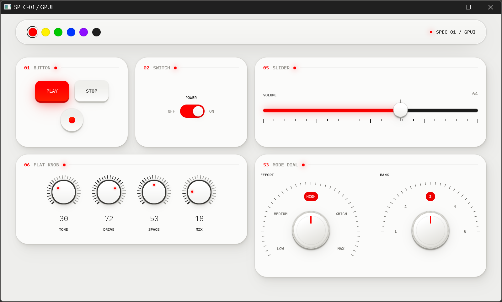

# SPEC-01 / GPUI

A native desktop port of five [SPEC-01/HARDWARE](https://spec-01.vercel.app)
components, built with [gpui](https://gpui.rs) (Zed's GPU-accelerated UI
framework). It's a feasibility test: can the hardware look be reproduced natively,
with no web view, as a small single executable for Windows and Linux?



Components: **Button**, **Switch**, **Slider**, **Flat knob**, **Mode dial**, plus
the navbar key picker. All six key colours re-theme the whole app live.

| Interaction | |
|---|---|
| Keys | press and release; the key sinks onto its lip |
| Switch | click; the thumb eases across |
| Slider | click or drag anywhere on it; Shift+wheel nudges |
| Knobs | drag up/down (2 px per step) or Shift+wheel |
| Mode dial | click a stop or the knob, or Shift+wheel over it; the knob eases round |

The components live in a library (`src/lib.rs`, `src/widgets/`). Each set of
five, with its state, is a `Rack` (`src/rack.rs`). Any view that implements
`rack::Host` can show racks, which is how both binaries share them.

## Build and run

Needs Rust (stable). The first build compiles gpui and takes a few minutes.

```sh
cargo run --release
```

The binary is `target/release/spec01` (`spec01.exe` on Windows), about 7 MB, with
fonts embedded. It's self-contained: copy it anywhere and run it.

### Windows

Works as-is with the MSVC toolchain. Release builds have no console window.

### Linux (X11 and Wayland)

Install gpui's system dependencies first (Debian/Ubuntu names):

```sh
sudo apt install gcc pkg-config libxkbcommon-x11-dev libxcb1-dev libwayland-dev \
  libfontconfig-dev libvulkan1 mesa-vulkan-drivers
curl --proto '=https' --tlsv1.2 -sSf https://sh.rustup.rs | sh
cargo run --release
```

gpui renders through Vulkan on Linux, so the machine needs a Vulkan driver. WSL2
on Windows 11 works through WSLg. **Not yet built on Linux in this repo.** The
WSL Ubuntu here lacks the packages above, which need `sudo`.

## Measured (Windows 11, 150% scaling)

Release build compared with the same five components as a web page in an Edge app
window (`.local/bench5.html`), each measured 4 s after launch:

| | gpui | Edge |
|---|---|---|
| Processes | 1 | 12 |
| Memory, working set | 101 MB | 739 MB |
| Memory, private | 67 MB | 357 MB |
| Time to window | 0.6 s | 0.77 s |
| Binary | 6.9 MB | (browser) |

## Stress test

`stress` shows a wall of up to 50,000 widgets of **23 kinds**. Widgets pack
into rows that re-flow when you resize the window or zoom, and the wall is
virtualized, so only on-screen rows are built.

```sh
cargo run --release --bin stress -- --widgets 20000 --zoom 0.35 --motion wave --hue
```

- **Zoom:** Ctrl+= / Ctrl+- / Ctrl+0, or Ctrl+wheel. Every size is scaled, so
  zooming re-lays everything out.
- **Scrolling:** a draggable scrollbar (clicking the track pages), the mouse
  wheel, PgUp/PgDn/Home/End and the arrow keys.
- **Controls bar:**
  - layout: MIXED / GROUPED (by kind, with headers)
  - motion: OFF / NOISE / WAVE (a wave that ripples across the whole wall)
  - toggles: HUE (rotates the key colour), SCROLL, CULL
  - widget counts and zoom
  - a live frame-time graph, FPS, render-build time, and widgets on screen
- **Keys:** M motion, H hue, S scroll, L layout.
- **Flags:** `--widgets N`, `--zoom Z`, `--layout mixed|grouped`,
  `--motion off|noise|wave`, `--hue`, `--scroll`, `--no-cull`, `--kind NAME`,
  `--bench SECS`, `--suite [FILE] --label NAME`.

### Comparing machines

```sh
./target/release/stress --suite bench/<label>.jsonl --label <label>   # ~1 min, keep the window in front
python3 tools/compare-bench.py bench/*.jsonl
```

The suite runs 8 fixed scenarios (zoom 100% to 25%, up to 50,000 widgets). It
writes one JSON line per scenario, with FPS, p50/p95/p99 frame times, build time
and platform info. `bench/windows-rtx2060.jsonl` is the Windows baseline.

### What made it faster (Windows, RTX 2060 laptop)

| Change | Busy view (35% zoom, ~105 widgets animating) |
|---|---|
| first version, on the Intel iGPU | 71 ms/frame |
| level-of-detail shadow trimming | 56 ms |
| exporting `NvOptimusEnablement` so it runs on the RTX (gpui picks the first adapter) | 33 ms |
| drawing dots, ticks and grids as GPU quads; monospace rows as one text run | 24 ms |
| greeking unreadable text | **21 ms (46 FPS)** |

At 60% zoom and above (about 35 widgets on screen) it holds 60 FPS, this
display's refresh rate. What's left is gpui's CPU cost per element (layout and
paint), not the GPU.

## How it maps from the web version

- **Colours** (`src/theme.rs`): the same OKLCH key colour and the same derived
  tokens as `tokens.css` (`--key-ink`, `--key-lamp`, `--key-cap`, `--on-accent`).
  They're converted to sRGB in Rust, and out-of-gamut colours are clipped the way
  the browser clips them.
- **Measurements**: taken from the browser's computed styles for each part (sizes,
  radii, shadow stacks, font sizes), so the numbers match the skin.
- **Tick rings, scales, knurling and the dial pointer**: drawn as stroked paths
  on a `canvas`.
- **State**: one view (`src/gallery.rs`) holds all control state. Drags are
  routed from the window root. Eased values (switch thumb, dial pointer) advance
  each frame and request another frame only while they're moving.

### gpui gaps and the workarounds used

| CSS feature | gpui 0.2 | Done here |
|---|---|---|
| `box-shadow: inset` | no | lighter gradients or borders instead |
| shadow with `blur: 0` | draws nothing | minimum 0.5 px blur (`ui::sh`) |
| shadow spread keeps a circle round | corner radius doesn't grow | nested circles (key picker ring) |
| radial / conic gradients | linear, 2 stops only | linear approximations; conic scales drawn as paths |
| `corner-shape: squircle` | no | smaller plain radii |
| `letter-spacing` | no | none (labels are slightly tighter) |
| `transform: rotate` on elements | no | rotating parts drawn as paths, or positioned with trig |

One gotcha: `Window::request_animation_frame` may only be called during
render or paint, not in an event handler. Calling it in a handler panics, and in a
release build that aborts the app.

## Not done yet

- **Sounds and haptics.** The web version synthesizes clicks with Web Audio.
  A port would use `cpal` or `rodio` with the same synthesis from `lib/sound.ts`.
- **Keyboard focus and navigation**, and accessibility.
- **The other 47 components.**
- **Packaging** (`.msi`, `.deb`, AppImage), e.g. with `cargo-packager`.

## Licences

Code in this folder follows the repo. The design is SPEC-01/HARDWARE © Shu Ding,
MIT. IBM Plex Mono is under the SIL Open Font License (`assets/fonts/OFL.txt`).
gpui is Apache-2.0.
